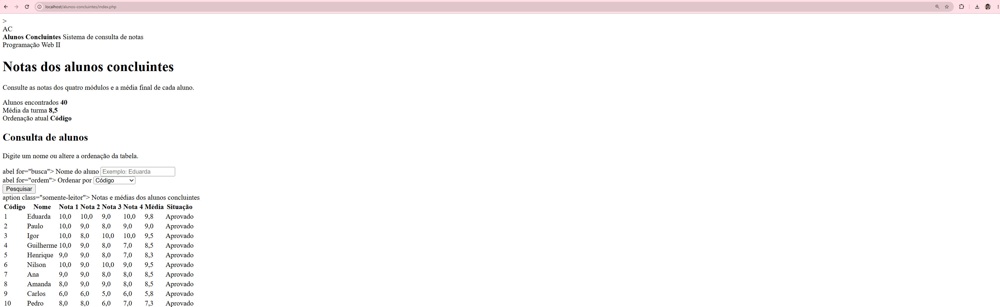
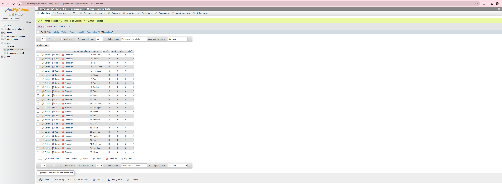

# Sistema de Alunos Concluintes

Atividade de recuperação da disciplina de Desenvolvimento de Sistemas II.

## Objetivo

Desenvolver uma página PHP que se conecte a um banco de dados
MySQL e apresente as notas dos alunos concluintes.

## Funcionalidades

- Conexão com banco de dados MySQL
- Exibição dos alunos em uma tabela HTML
- Exibição das quatro notas
- Cálculo da média de cada aluno
- Busca por nome
- Ordenação alfabética
- Ranking da maior média para a menor
- Exibição da situação do aluno
- Layout responsivo

## Tecnologias utilizadas

- PHP
- MySQL
- HTML5
- CSS3
- PDO

## Como executar

1. Instale e abra o XAMPP.
2. Inicie Apache e MySQL.
3. Copie a pasta `alunos-concluintes` para `htdocs`.
4. Importe o arquivo `banco.sql` pelo phpMyAdmin.
5. Abra no navegador:

http://localhost/alunos-concluintes/

## Banco de dados

- Banco: `pwii`
- Tabela: `alunoconcluinte`

## Arquivos

- `banco.sql`: cria o banco, a tabela e os registros
- `conexao.php`: realiza a conexão com o MySQL
- `index.php`: consulta e exibe os alunos
- `estilo.css`: estiliza a página

## Prints

## Relatório com as perguntas e respostas obtidas da IA

Durante o desenvolvimento da atividade alunos-concluintes, a Inteligência Artificial foi utilizada como apoio para organizar a estrutura do sistema, melhorar o visual da página e revisar a lógica do código PHP com MySQL.

Perguntas feitas e respostas obtidas
1. Como criar uma página PHP que se conecte ao banco de dados MySQL?
Resposta obtida: foi sugerido criar um arquivo separado de conexão, usando PHP com PDO, informando servidor, nome do banco, usuário, senha e charset. Também foi orientado tratar possíveis erros de conexão com try e catch.

2. Como exibir os alunos em uma tabela HTML usando os dados do banco?
Resposta obtida: foi orientado fazer uma consulta SQL com SELECT, executar essa consulta no PHP e usar um laço foreach para mostrar cada aluno em uma linha da tabela.

3. Como calcular a média das quatro notas de cada aluno?
Resposta obtida: foi sugerido calcular a média somando nota1, nota2, nota3 e nota4, depois dividindo o resultado por 4. Esse cálculo poderia ser feito diretamente na consulta SQL ou no PHP.

4. Como criar uma busca por nome do aluno?
Resposta obtida: foi recomendado usar um campo de pesquisa no formulário e aplicar a cláusula WHERE nome LIKE :busca na consulta SQL, usando parâmetro para deixar a busca mais segura.

5. Como exibir um ranking dos alunos pela maior média?
Resposta obtida: foi sugerido ordenar os resultados usando ORDER BY media DESC, para que os alunos com maior média aparecessem primeiro.

6. Como deixar a página com aparência mais agradável?
Resposta obtida: foi recomendado usar CSS para melhorar a interface, com cores suaves, cartões de resumo, botões melhores, tabela mais organizada, espaçamento adequado e adaptação para celular.

7. Como melhorar o CSS para um visual mais moderno?
Resposta obtida: foi sugerido atualizar o arquivo estilo.css com tipografia mais atual, sombras leves, bordas arredondadas, efeitos de hover, cabeçalho fixo, layout responsivo e versão mobile da tabela.

Resultado do uso da IA
O uso da Inteligência Artificial ajudou a:

Organizar melhor os arquivos do projeto.

Entender a lógica da conexão com o banco.

Montar a busca por nome.

Criar o cálculo da média.

Exibir os dados em tabela.

Melhorar o design da página com CSS.

Corrigir dúvidas de estrutura e execução no XAMPP.
